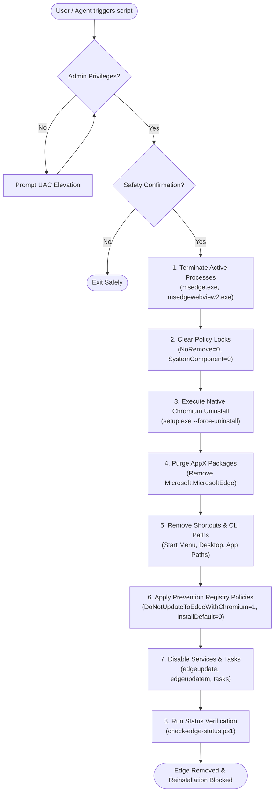

# Microsoft Edge & WebView2 Removal and Prevention Toolkit

[](https://microsoft.com/windows)
[](https://github.com/PowerShell/PowerShell)
[](LICENSE)
[](SKILL.md)

A battle-tested, non-technical automation suite and standardized AI agent skill to cleanly uninstall Microsoft Edge and WebView2, purge leftover shortcuts and registrations, and permanently block Windows Update from reinstalling them.

---

## ⚡ Quick Start (Single-Click Execution)

No command line experience is required! Simply open the `scripts` folder in File Explorer:

| Action | What It Does | Launcher File |
|---|---|---|
| **Audit Status** | Checks if Edge or WebView2 is installed, running, or blocked. | Double-click `scripts\check-edge-status.bat` |
| **Remove Edge** | Unlocks policies, uninstalls Edge, cleans shortcuts, and blocks updates. | Right-click `scripts\remove-edge.bat` and select **Run as administrator** |
| **Restore Edge** | Clears blocker policies and enables services to allow reinstallation. | Right-click `scripts\restore-edge.bat` and select **Run as administrator** |

> **User Account Control (UAC) Note**: When double-clicking `.bat` files, Windows will display a User Account Control prompt asking: *"Do you want to allow this app to make changes to your device?"* Click **Yes** to grant the required administrator permissions.

---

## 🧠 AI Agent Integration Index

This repository natively implements the open [Agent Skills specification](https://agentskills.io) and includes native support for leading AI platforms:

| Platform | Entry Point | Setup Guide | Capabilities |
|---|---|---|---|
| **Google Antigravity** | [`SKILL.md`](SKILL.md) | [Antigravity Guide](docs/antigravity-guide.md) | Full autonomous audit, removal, and policy enforcement via standard YAML frontmatter. |
| **Claude Code** | [`CLAUDE.md`](CLAUDE.md) & [`.claude/`](.claude/) | [Claude Code Guide](docs/claude-code-guide.md) | Project instructions and `/edge-removal` slash command with granular tool permissions. |
| **OpenAI ChatGPT** | [`chatgpt/`](chatgpt/) | [ChatGPT Guide](docs/chatgpt-guide.md) | Custom GPT instructions, conversation starters, knowledge base docs, and OpenAPI schema. |

---

## 💻 Manual Execution via PowerShell

If you prefer using Windows PowerShell directly:

```powershell
# 1. Audit current system status (Human-readable table)
powershell.exe -NoProfile -ExecutionPolicy Bypass -File scripts\check-edge-status.ps1

# 2. Audit current status (Machine-readable JSON)
powershell.exe -NoProfile -ExecutionPolicy Bypass -File scripts\check-edge-status.ps1 -Json

# 3. Perform uninstallation & enforce permanent blocker policies
powershell.exe -NoProfile -ExecutionPolicy Bypass -File scripts\remove-edge.ps1 -Force

# 4. Restore policies and services (if you ever wish to reinstall Edge)
powershell.exe -NoProfile -ExecutionPolicy Bypass -File scripts\restore-edge.ps1 -Force
```

---

## 🛠️ How It Works Under the Hood



Standard Windows settings disable the "Uninstall" button for Microsoft Edge. This package systematically bypasses those restrictions:

1. **Process Lock Termination**: Repeatedly stops file-locking background processes (`msedge.exe`, `msedgewebview2.exe`, `SearchHost.exe`) so files can be removed without restart.
2. **Policy Unlock**: Clears `NoRemove` and `SystemComponent` flags in `HKLM:\SOFTWARE\WOW6432Node\Microsoft\Windows\CurrentVersion\Uninstall`.
3. **Native Chromium Uninstallation**: Executes the embedded installer with `--uninstall --system-level --verbose-logging --force-uninstall`.
4. **AppX Package Purging**: Removes provisioned and user-scoped `Microsoft.MicrosoftEdge` AppX packages.
5. **Shortcut & App Paths Purge**: Erases `.lnk` files from Start Menu, Desktop, and Quick Launch, and removes `App Paths\msedge.exe`.
6. **Reinstallation Prevention**:
   - Sets `DoNotUpdateToEdgeWithChromium = 1` in both 32-bit and 64-bit EdgeUpdate hives.
   - Enforces Enterprise Group Policies (`InstallDefault = 0`, `UpdateDefault = 0`, and per-app GUID blocks).
   - Disables update services (`edgeupdate`, `edgeupdatem`, `MicrosoftEdgeElevationService`).
   - Disables scheduled update tasks.

---

## 📂 Repository Directory Layout

```
edge-removal-skill/
├── SKILL.md                          # Google Antigravity & AgentSkills specification
├── CLAUDE.md                         # Claude Code root workspace guidelines
├── README.md                         # This file
├── .gitignore                        # Clean git configuration
├── .claude/
│   ├── settings.json                 # Claude Code tool execution permissions
│   └── skills/
│       └── edge-removal/
│           └── SKILL.md              # Claude Code /edge-removal skill entry
├── chatgpt/
│   ├── custom-instructions.md        # Copy-paste prompt for Custom GPT
│   ├── conversation-starters.json    # Starter questions for GPT interface
│   ├── gpt-setup-guide.md            # Step-by-step GPT configuration manual
│   └── openapi.yaml                  # OpenAPI 3.1.0 REST schema
├── scripts/
│   ├── remove-edge.ps1               # Automated removal & blocker engine
│   ├── remove-edge.bat               # Single-click removal launcher
│   ├── check-edge-status.ps1         # Status verification engine (-Json support)
│   ├── check-edge-status.bat         # Single-click status launcher
│   ├── restore-edge.ps1              # Policy reversal & service restoration engine
│   └── restore-edge.bat              # Single-click restore launcher
└── docs/
    ├── quick-start.md                # 1-minute non-technical execution guide
    ├── technical-reference.md        # Deep dive into keys, GUIDs, and arguments
    ├── antigravity-guide.md          # Antigravity agent integration guide
    ├── claude-code-guide.md          # Claude Code CLI setup guide
    ├── chatgpt-guide.md              # ChatGPT Custom GPT guide
    └── troubleshooting.md            # Troubleshooting locks, policies, and UAC
```

---

## ⚠️ Important Safety Notice Regarding WebView2

Microsoft Edge and Microsoft Edge WebView2 are distinct components:
- **Microsoft Edge**: The standalone web browser application.
- **WebView2 Runtime**: An embedded web browser control used by desktop applications (such as Microsoft Teams, Outlook, and desktop widgets) to render web content.

`scripts\remove-edge.ps1` purges both Edge and WebView2 by default. If you use applications that require WebView2, you can easily restore WebView2 at any time:
```powershell
powershell.exe -NoProfile -ExecutionPolicy Bypass -File scripts\restore-edge.ps1 -Force
winget install Microsoft.EdgeWebView2Runtime
```

---

## 👥 Contributors

- **[Nikhil Madhusudhan](https://github.com/madhusudhan-nikhil)** — Project Lead & Author
- **[Antigravity](https://github.com/google-deepmind)** (Google DeepMind) — Autonomous Multi-Agent Systems Architecture, Tooling & Verification

---

## 📄 License

This project is licensed under the [MIT License](LICENSE).
